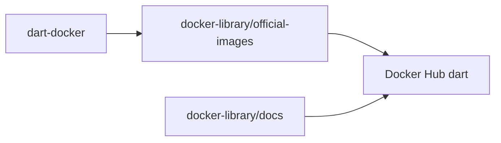

# dart-lang/dart-docker

> Dépôt Git des images Docker officielles du langage Dart, pour les développeurs Dart.

## Le problème
Obtenir un environnement Dart reproductible en conteneur sans construire soi-même l'image.

## Ce que ça fait vraiment
Le README est minimal : il indique que le dépôt contient la source des images « Docker Official Images » pour Dart et renvoie vers la page Docker Hub pour l'usage. Le contenu des images n'est pas décrit ici.

## Comment c'est branché
Schéma simplifié d'après la fiche, sans diagramme fourni.

## Essayer
Aucune commande documentée dans le README. Voir la page Docker Hub.

## Coût et pièges
Docker requis. Les instructions d'usage et les problèmes sont gérés ailleurs, sur Docker Hub.

## Ce que ce n'est pas
Ce n'est pas le SDK Dart ni un outil : ce sont les définitions d'images. Peu de matière pour juger davantage.

## Alternatives
Aucune alternative nommée dans le README.

## Pour toi
Ignorer : utile seulement pour conteneuriser du Dart, hors de ton périmètre data, IA ou MLOps.

