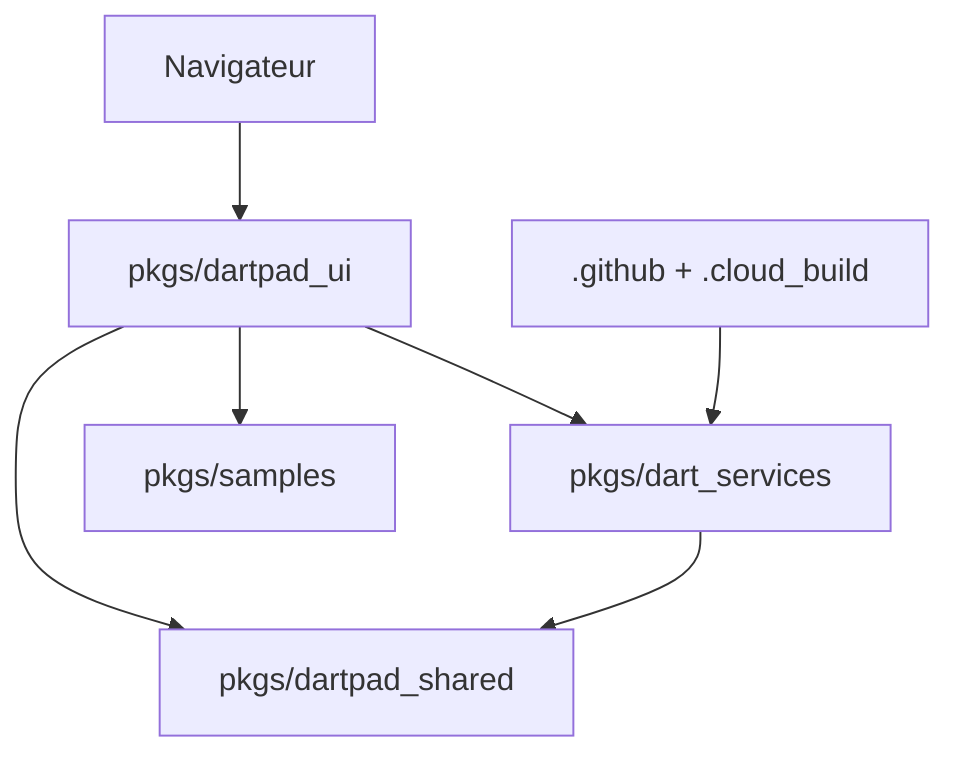

# dart-lang/dart-pad

> Free online editor for learning Dart and Flutter, embeddable in an iframe.

## The problem
Try Dart or Flutter code without installing an SDK or a toolchain.

## What it actually does
The browser loads the interface (dartpad_ui, in Flutter), which sends the code to the dart_services service to analyze it, compile it and display the result. Shared code (dartpad_shared) and examples (samples) complete the repository. Usable at dartpad.dev.

## How it is wired


## Trying it
```bash
# Aucune commande documentée dans le README : le service est utilisable sur dartpad.dev.
```

## Cost and gotchas
Free. Running your own instance requires the Dart SDK, Flutter and hosting; the README does not describe the procedure.

## What it is not
Not a full IDE; not designed for multi-file projects or arbitrary dependencies.

## Alternatives
No alternative named in the README.

## For you
Ignore: Dart and Flutter sandbox, useful only if you write Dart, which is not your data / AI / MLOps profile.
