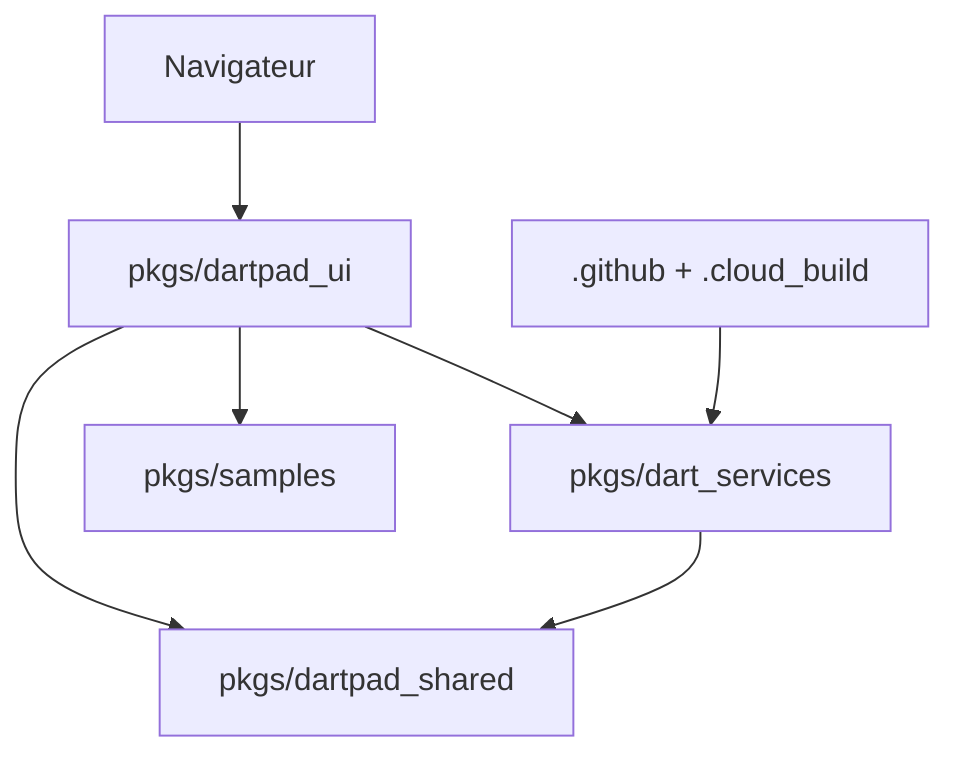

# dart-lang/dart-pad

> Éditeur en ligne gratuit pour apprendre Dart et Flutter, intégrable dans un iframe.

## Le problème
Essayer du code Dart ou Flutter sans installer de SDK ni de chaîne d'outils.

## Ce que ça fait vraiment
Le navigateur charge l'interface (dartpad_ui, en Flutter) qui envoie le code au service dart_services pour l'analyser, le compiler et en afficher le résultat. Du code partagé (dartpad_shared) et des exemples (samples) complètent le dépôt. Utilisable sur dartpad.dev.

## Comment c'est branché


## Essayer
```bash
# Aucune commande documentée dans le README : le service est utilisable sur dartpad.dev.
```

## Coût et pièges
Gratuit. Faire tourner sa propre instance suppose le SDK Dart, Flutter et un hébergement ; le README n'en décrit pas la procédure.

## Ce que ce n'est pas
Pas un IDE complet ; pas conçu pour des projets multi-fichiers ni pour des dépendances arbitraires.

## Alternatives
Aucune alternative nommée dans le README.

## Pour toi
À ignorer : bac à sable Dart et Flutter, utile seulement si tu écris du Dart, ce qui n'est pas ton profil data / IA / MLOps.

