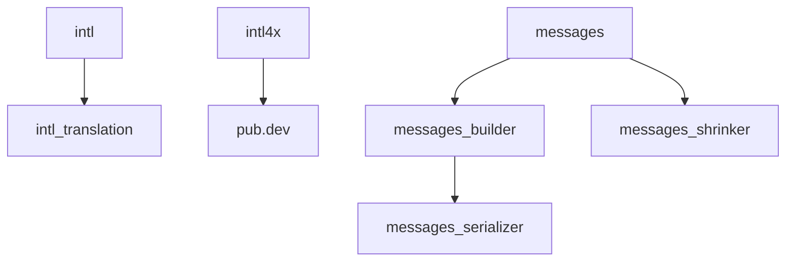

# dart-lang/i18n

> Repository of the Dart internationalization and localization packages: intl, intl4x and the messages family.

## The problem
Dart and Flutter applications need to format dates, numbers and messages according to the language.

## What it actually does
A multi-package repository: intl for messages, dates and numbers; intl4x, a modular version; intl_translation; messages with its companions builder, serializer and shrinker. A release automation is described on an external wiki.

## How it is wired
Simplified diagram based on the sheet, no diagram provided.



## Trying it
```bash
# Aucune commande documentée dans le README
```

## Cost and gotchas
Free. 223 open issues: a busy project. The README shows no installation.

## What it is not
Not a machine translation tool: it is about formatting and message management.

## Alternatives
- No alternative named in the README.

## For you
Ignore: reserved for Dart and Flutter developers.
