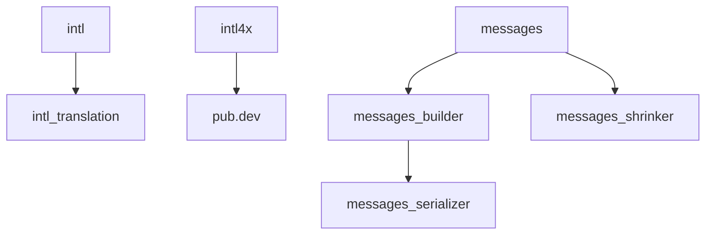

# dart-lang/i18n

> Dépôt des paquets Dart d'internationalisation et de localisation : intl, intl4x et la famille messages.

## Le problème
Les applications Dart et Flutter doivent formater dates, nombres et messages selon la langue.

## Ce que ça fait vraiment
Un dépôt multi-paquets : intl pour messages, dates et nombres ; intl4x, version modulaire ; intl_translation ; messages avec ses compagnons builder, serializer et shrinker. Une automatisation de publication est décrite sur un wiki externe.

## Comment c'est branché
Schéma simplifié d'après la fiche, sans diagramme fourni.



## Essayer
```bash
# Aucune commande documentée dans le README
```

## Coût et pièges
Gratuit. 223 tickets ouverts : un projet chargé. Le README ne montre aucune installation.

## Ce que ce n'est pas
Pas un outil de traduction automatique : de la mise en forme et de la gestion de messages.

## Alternatives
- Aucune alternative nommée dans le README.

## Pour toi
Ignorer : réservé aux développeurs Dart et Flutter.

