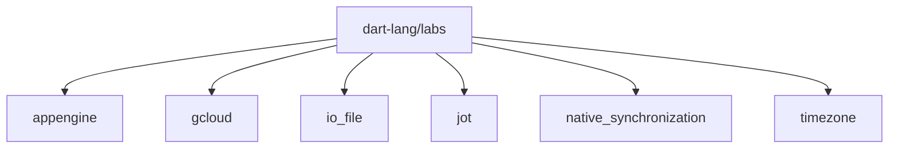

# dart-lang/labs

> Repository of experimental Dart packages published under labs.dart.dev, including gcloud, timezone and appengine.

## The problem
The Dart team needs a place for packages that are useful but outside the core of the language.

## What it actually does
The repository groups six packages: appengine (Dart runtime on App Engine Flexible), gcloud (API for Cloud Storage, Pub/Sub, Datastore), io_file (file access), jot (experimental documentation generator), native_synchronization (primitives based on dart:ffi) and timezone (time zone databases). Publishing is automated.

## How it is wired
Simplified diagram based on the sheet, no diagram provided.

## Trying it
No command documented in the README: the packages are installed from pub.dev.

## Cost and gotchas
Experimental packages with varying stability; gcloud and appengine assume a Google Cloud account.

## What it is not
Not a single package: a repository of independent packages, each with its own issues.

## Alternatives
No alternative named in the README.

## For you
Ignore: Dart packages unrelated to data, AI or MLOps work.
