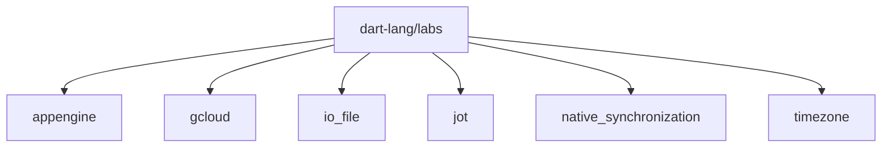

# dart-lang/labs

> Dépôt de paquets Dart expérimentaux publiés sous labs.dart.dev, dont gcloud, timezone et appengine.

## Le problème
L'équipe Dart a besoin d'un lieu pour des paquets utiles mais hors du cœur du langage.

## Ce que ça fait vraiment
Le dépôt regroupe six paquets : appengine (runtime Dart sur App Engine Flexible), gcloud (API pour Cloud Storage, Pub/Sub, Datastore), io_file (accès fichiers), jot (générateur de documentation expérimental), native_synchronization (primitives basées sur dart:ffi) et timezone (bases de fuseaux horaires). La publication est automatisée.

## Comment c'est branché
Schéma simplifié d'après la fiche, sans diagramme fourni.

## Essayer
Aucune commande documentée dans le README : les paquets s'installent depuis pub.dev.

## Coût et pièges
Paquets expérimentaux dont la stabilité varie ; gcloud et appengine supposent un compte Google Cloud.

## Ce que ce n'est pas
Pas un paquet unique : un dépôt de paquets indépendants, chacun avec ses propres issues.

## Alternatives
Aucune alternative nommée dans le README.

## Pour toi
À ignorer : paquets Dart sans lien avec un travail data, IA ou MLOps.

