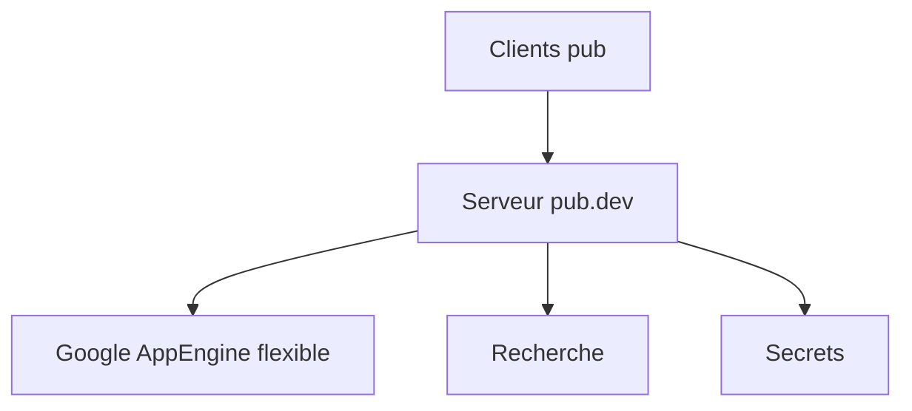

# dart-lang/pub-dev

> Server code of the pub.dev site, which hosts Dart packages, on Google AppEngine.

## The problem
The Dart community needs a central package registry, with search and versions.

## What it actually does
Very short README: the server is implemented on AppEngine with a custom runtime in the flexible environment, via the `appengine` package. The documentation points to pages on development, versions, secrets and search. Nothing more is described there.

## How it is wired

Simplified diagram based on the sheet, no diagram provided.

## Trying it
```bash
# Aucune commande dans le README : voir les pages Development et Secrets.
```

## Cost and gotchas
Free to read, but operating it assumes Google Cloud. The code is not meant for private hosting. 198 open issues.

## What it is not
Not a private registry ready to deploy: it is the code of the pub.dev site itself, designed to be operated by the Dart team, not an application to install at your place.

## Alternatives
No alternative named in the README.

## For you
Ignore: only useful for understanding the Dart registry; no data/AI use.
