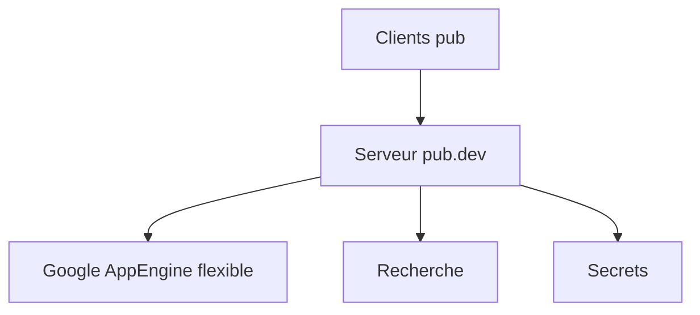

# dart-lang/pub-dev

> Code du serveur du site pub.dev, qui héberge les paquets Dart, sur Google AppEngine.

## Le problème
La communauté Dart a besoin d'un registre central de paquets, avec recherche et versions.

## Ce que ça fait vraiment
README très court : le serveur est implémenté sur AppEngine avec runtime personnalisé en environnement flexible, via le paquet `appengine`. La documentation renvoie à des pages sur le développement, les versions, les secrets et la recherche. Rien de plus n'y est décrit.

## Comment c'est branché

Schéma simplifié d'après la fiche, sans diagramme fourni.

## Essayer
```bash
# Aucune commande dans le README : voir les pages Development et Secrets.
```

## Coût et pièges
Gratuit à lire, mais l'exploitation suppose Google Cloud. Le code n'est pas prévu pour un hébergement privé. 198 tickets ouverts.

## Ce que ce n'est pas
Pas un registre privé prêt à déployer : c'est le code du site pub.dev lui-même, pensé pour être exploité par l'équipe Dart, pas une application à installer chez toi.

## Alternatives
Aucune alternative nommée dans le README.

## Pour toi
Ignorer : sert uniquement à comprendre le registre Dart ; pas d'usage data/IA.

