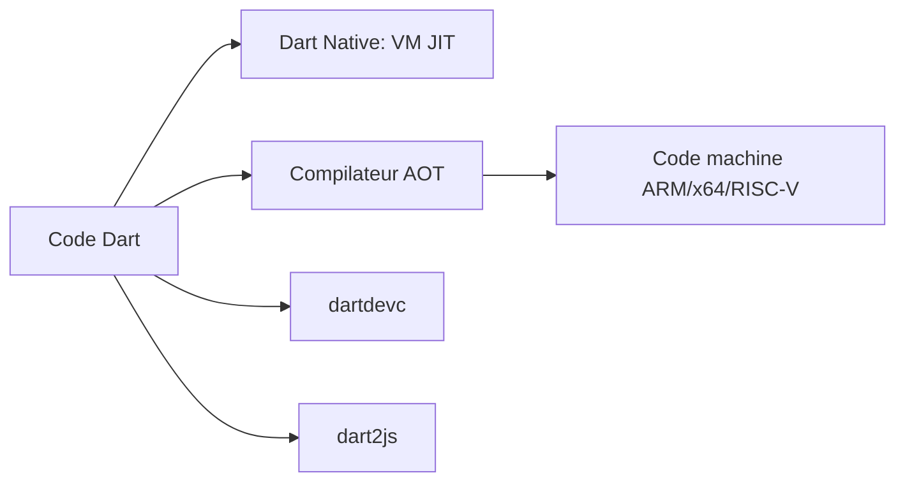

# dart-lang/sdk

> Dart language development kit, compiled for mobile, desktop, server and web.

## The problem
Writing a single typed codebase for several platforms, with fast iteration.

## What it actually does
The repository contains the SDK: a virtual machine with JIT and an AOT compiler to produce ARM, x64 or RISC-V code (Dart Native), as well as `dartdevc` (development) and `dart2js` (production) for the web (Dart Web). It also targets WebAssembly. The README points to dart.dev, pub.dev and a build guide.

## How it is wired

## Trying it
No commands documented in the README: it points to an external guide for getting the sources and building.

## Cost and gotchas
Free. Building the SDK yourself requires preparing the machine according to the guide. Nearly 8,500 open issues.

## What it is not
Not a UI framework (Flutter is not in this repository). Not a data/AI tool.

## Alternatives
None cited in the README.

## For you
Ignore: general-purpose language for applications, far from the Python/data ecosystem of your profile.
