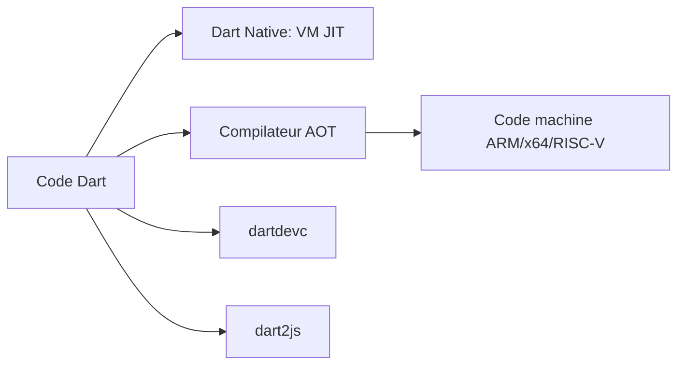

# dart-lang/sdk

> Kit de développement du langage Dart, compilé pour mobile, bureau, serveur et web.

## Le problème
Écrire une seule base de code typée pour plusieurs plateformes, avec itération rapide.

## Ce que ça fait vraiment
Le dépôt contient le SDK : une machine virtuelle avec JIT et un compilateur AOT pour produire du code ARM, x64 ou RISC-V (Dart Native), ainsi que `dartdevc` (développement) et `dart2js` (production) pour le web (Dart Web). Il cible aussi WebAssembly. Le README renvoie à dart.dev, pub.dev et à un guide de compilation.

## Comment c'est branché

## Essayer
Aucune commande documentée dans le README : il renvoie à un guide externe pour récupérer les sources et compiler.

## Coût et pièges
Gratuit. Compiler le SDK soi-même demande de préparer la machine selon le guide. Près de 8 500 issues ouvertes.

## Ce que ce n'est pas
Pas un framework d'interface (Flutter n'est pas dans ce dépôt). Pas un outil data/IA.

## Alternatives
Aucune citée dans le README.

## Pour toi
Ignorer : langage généraliste pour applications, éloigné de l'écosystème Python/data de ton profil.

