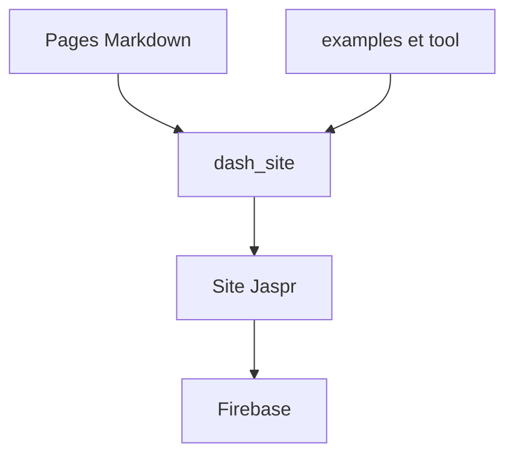

# dart-lang/site-www

> Sources of the dart.dev documentation site, built with Jaspr, for Dart documentation contributors.

## The problem
Contributing to the Dart language documentation requires knowing how to build and validate the site.

## What it actually does
Contains the site, built with Jaspr and hosted on Firebase. The `dash_site` tool serves, builds, checks code examples, refreshes excerpts and validates the tutorial code. Small fixes can be made through the GitHub interface.

## How it is wired
Simplified diagram based on the sheet, no diagram provided.



## Trying it
```bash
dart pub get
dart run dash_site --help
dart run dash_site serve
dart run dash_site check-all
```

## Cost and gotchas
Free. The stable Dart SDK is required, installed separately; a license is present but not identified by GitHub.

## What it is not
Not a tool or a library: the source code of a documentation site.

## Alternatives
No alternative named in the README.

## For you
Ignore: only of interest for contributing to the Dart docs.
