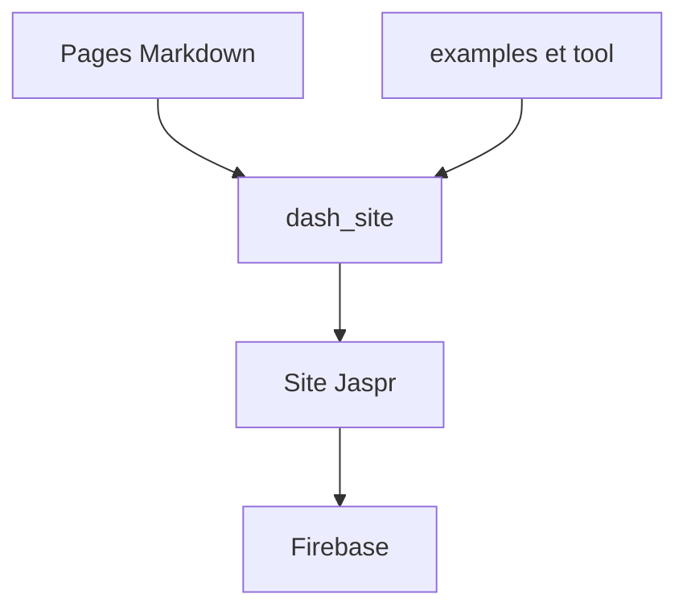

# dart-lang/site-www

> Sources du site de documentation dart.dev, construit avec Jaspr, pour contributeurs à la doc Dart.

## Le problème
Contribuer à la documentation du langage Dart suppose de savoir construire et valider le site.

## Ce que ça fait vraiment
Contient le site, construit avec Jaspr et hébergé sur Firebase. L'outil `dash_site` sert, génère, vérifie les exemples de code, rafraîchit les extraits et valide le code du tutoriel. Les petites corrections se font via l'interface GitHub.

## Comment c'est branché
Schéma simplifié d'après la fiche, sans diagramme fourni.



## Essayer
```bash
dart pub get
dart run dash_site --help
dart run dash_site serve
dart run dash_site check-all
```

## Coût et pièges
Gratuit. Il faut le SDK Dart stable, installé séparément ; licence présente mais non identifiée par GitHub.

## Ce que ce n'est pas
Pas un outil ni une bibliothèque : le code source d'un site de documentation.

## Alternatives
Aucune alternative nommée dans le README.

## Pour toi
À ignorer : intéressant seulement pour contribuer à la doc Dart.

