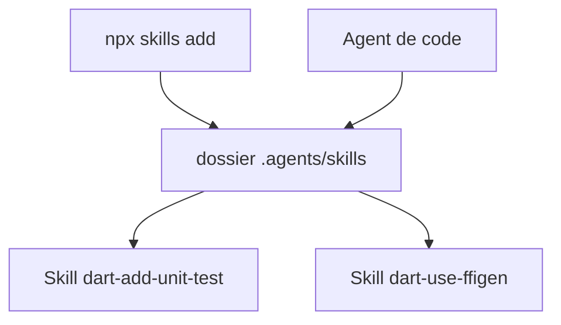

# dart-lang/skills

> Collection of skills for coding agents, maintained by the Dart team, covering common Dart tasks.

## The problem
An agent writes approximate Dart: tests, mocks, FFI, static analysis and package conflicts depend on precise rules.

## What it actually does
- Fifteen skills, folders of files for the agent to load.
- Covers unit tests, `mockito` mocks, coverage, migration to `package:checks`, analysis and fixes.
- Also covers FFI with `ffigen`, native assets, primary constructors, Dartdoc documentation.
- Installation via `skills.sh` into `.agents/skills`.

## How it is wired

Simplified diagram based on the sheet, no diagram provided.

## Trying it
```bash
npx skills add dart-lang/skills --skill '*' --agent universal --yes
npx skills update
```

## Cost and gotchas
Free; Node is required for `npx`. The agent must be compatible with the skills format. An error-fixing skill assumes the Dart MCP server.

## What it is not
Not a Dart tool: it installs no SDK. It complements the MCP rather than replacing it.

## Alternatives
No alternative named in the README, apart from the skills for Flutter.

## For you
Ignore, unless you write Dart: nothing here serves data, AI or MLOps work in Python.
