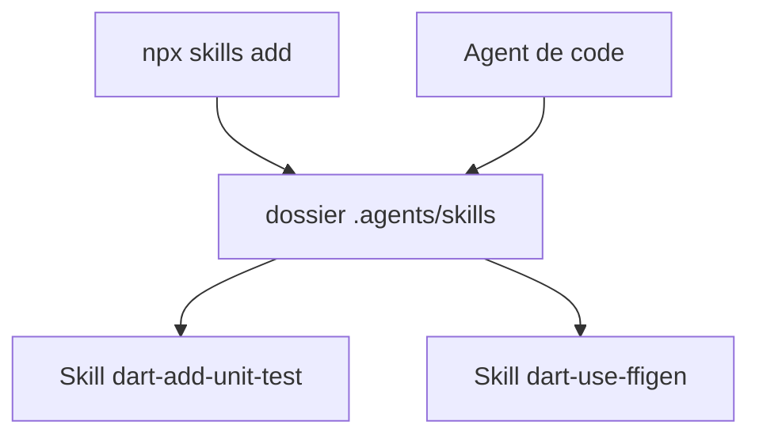

# dart-lang/skills

> Collection de skills pour agents de code, maintenue par l'équipe Dart, sur les tâches courantes en Dart.

## Le problème
Un agent écrit du Dart approximatif : tests, mocks, FFI, analyse statique et conflits de paquets reposent sur des règles précises.

## Ce que ça fait vraiment
- Quinze skills, dossiers de fichiers à charger par l'agent.
- Couvre tests unitaires, mocks `mockito`, couverture, migration vers `package:checks`, analyse et correctifs.
- Couvre aussi FFI avec `ffigen`, assets natifs, constructeurs primaires, documentation Dartdoc.
- Installation via `skills.sh` dans `.agents/skills`.

## Comment c'est branché

Schéma simplifié d'après la fiche, sans diagramme fourni.

## Essayer
```bash
npx skills add dart-lang/skills --skill '*' --agent universal --yes
npx skills update
```

## Coût et pièges
Gratuit ; Node est requis pour `npx`. L'agent doit être compatible avec le format de skills. Un skill de correction d'erreurs suppose le serveur MCP de Dart.

## Ce que ce n'est pas
Pas un outil Dart : il n'installe aucun SDK. Il complète le MCP au lieu de le remplacer.

## Alternatives
Aucune alternative nommée dans le README, hormis les skills pour Flutter.

## Pour toi
À ignorer, sauf si tu écris du Dart : rien ici ne sert un travail data, IA ou MLOps en Python.

