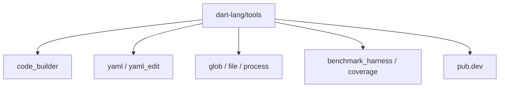

# dart-lang/tools

> Monorepo of Dart tooling packages published on pub.dev, for Dart developers.

## The problem
Dart tooling packages without a thematic repository of their own would be scattered.

## What it actually does
Groups about forty packages: YAML parsing, glob, mockable files and processes, code generation (code_builder), version semantics, HTML/CSS/Markdown parsing, benchmarks, coverage, OAuth2, etc. Each is published separately on pub.dev, with issue tracking by label.

## How it is wired
Simplified diagram based on the fiche, no diagram provided.



## Trying it
```bash
# aucune commande dans le README : chaque paquet s'installe depuis pub.dev
```

## Cost and gotchas
Free. Over 600 open issues: a very active but heavily loaded repository. The Dart SDK is required to use the packages.

## What it is not
Not a single tool: a collection of independent packages. No link with Python or data.

## Alternatives
No alternative named in the README.

## For you
Ignore: Dart tooling packages, with no use in a data / AI / MLOps chain.
