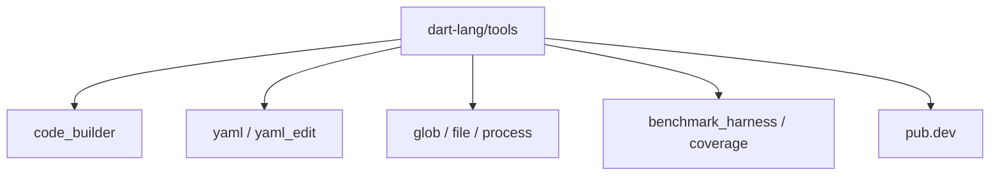

# dart-lang/tools

> Monorepo de paquets Dart d'outillage publiés sur pub.dev, pour développeurs Dart.

## Le problème
Des paquets d'outillage Dart sans dépôt thématique propre seraient dispersés.

## Ce que ça fait vraiment
Regroupe une quarantaine de paquets : analyse YAML, glob, fichiers et processus simulables, génération de code (code_builder), sémantique de versions, parsing HTML/CSS/Markdown, benchmarks, couverture, OAuth2, etc. Chacun est publié séparément sur pub.dev, avec un suivi d'issues par étiquette.

## Comment c'est branché
Schéma simplifié d'après la fiche, sans diagramme fourni.



## Essayer
```bash
# aucune commande dans le README : chaque paquet s'installe depuis pub.dev
```

## Coût et pièges
Gratuit. Plus de 600 issues ouvertes : dépôt très actif mais chargé. Il faut le SDK Dart pour utiliser les paquets.

## Ce que ce n'est pas
Pas un outil unique : une collection de paquets indépendants. Aucun lien avec Python ni la data.

## Alternatives
Aucune alternative nommée dans le README.

## Pour toi
Ignorer : paquets Dart d'outillage, sans usage dans une chaîne data / IA / MLOps.

