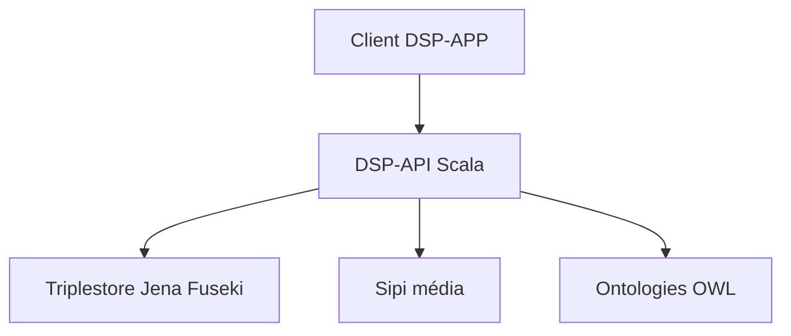

# dasch-swiss/dsp-api

> API server for storing and querying humanities research data, for institutions and researchers.

## The problem
Primary-source data in the humanities is heterogeneous and hard to link, version and share in a standard way.

## What it actually does
Stores data as RDF graphs in a triplestore (tested with Jena Fuseki) and binary files via Sipi (C++ media server). Exposes a Scala HTTP API to query, annotate and link the data. Handles authentication, permissions and automatic versioning; relies on OWL ontologies.

## How it is wired


## Trying it
```bash
just init-db-test
just stack-up
just stack-stop
just test-unit
```

## Cost and gotchas
Free. Requires Linux or macOS, Docker Desktop, Nix with flakes and direnv; Bazel build with JDK Temurin 25. A `mounts denied` error is possible under Docker Desktop.

## What it is not
Not a generic data platform: it targets the digital humanities. Contributions first go through a contact with the team.

## Alternatives
None named in the README.

## For you
Ignore: humanities domain and RDF/Scala stack outside your profile, unless you have a knowledge graph project.
