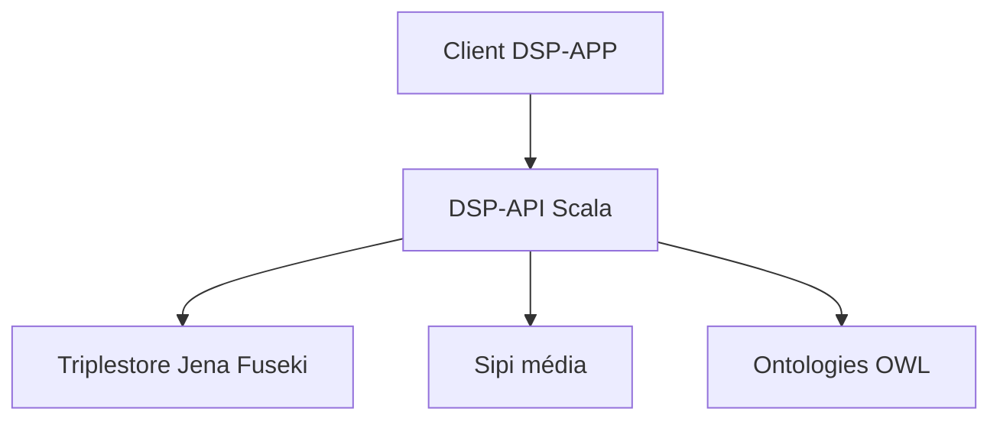

# dasch-swiss/dsp-api

> Serveur d'API pour stocker et interroger des données de recherche en sciences humaines, pour institutions et chercheurs.

## Le problème
Les données de sources primaires en humanités sont hétérogènes et difficiles à lier, versionner et partager de façon standard.

## Ce que ça fait vraiment
Stocke les données sous forme de graphes RDF dans un triplestore (testé avec Jena Fuseki) et les fichiers binaires via Sipi (serveur média C++). Expose une API HTTP en Scala pour interroger, annoter et lier les données. Gère authentification, autorisations et versionnement automatique ; s'appuie sur des ontologies OWL.

## Comment c'est branché


## Essayer
```bash
just init-db-test
just stack-up
just stack-stop
just test-unit
```

## Coût et pièges
Gratuit. Exige Linux ou macOS, Docker Desktop, Nix avec flakes et direnv ; build Bazel avec JDK Temurin 25. Erreur `mounts denied` possible sous Docker Desktop.

## Ce que ce n'est pas
Pas une plateforme générique de données : elle vise les humanités numériques. Les contributions passent d'abord par un contact avec l'équipe.

## Alternatives
Aucune nommée dans le README.

## Pour toi
Ignorer : domaine humanités et stack RDF/Scala hors profil, sauf projet de graphes de connaissances.

