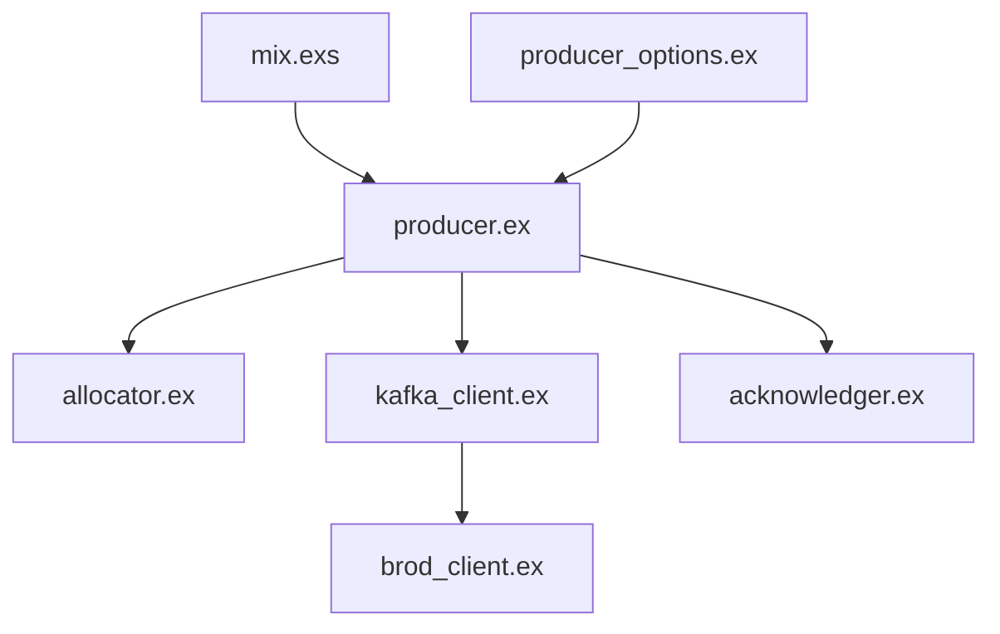

# dashbitco/broadway_kafka

> Kafka connector for Broadway, the Elixir stream-processing library, aimed at Elixir developers.

## The problem
Consuming Kafka messages in a Broadway pipeline requires handling consumer groups, partitions and acknowledgements.

## What it actually does
A Broadway producer validates its options, distributes partitions with an allocator, reads messages through the brod client and acknowledges them with an acknowledger. Configuration boils down to hosts, group and topics.

## How it is wired


## Trying it
```elixir
def deps do
  [
    {:broadway_kafka, "~> 0.4.1"}
  ]
end
```

## Cost and gotchas
Free. You need a Kafka broker and an Elixir project. No license is declared in the catalog.

## What it is not
Not a standalone Kafka client: it assumes Broadway and Elixir.

## Alternatives
No alternative named in the README.

## For you
Ignore: reserved for Elixir pipelines, whereas a data, AI or MLOps profile consumes Kafka in Python or Java.
