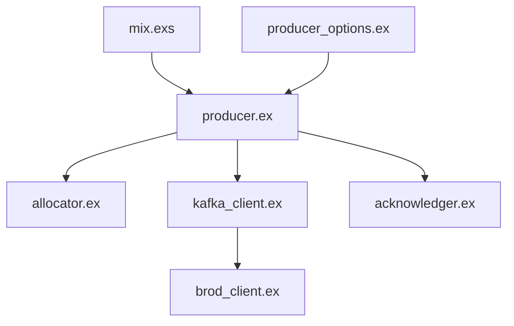

# dashbitco/broadway_kafka

> Connecteur Kafka pour Broadway, la bibliothèque Elixir de traitement de flux, destiné aux développeurs Elixir.

## Le problème
Consommer des messages Kafka dans un pipeline Broadway demande de gérer groupes de consommateurs, partitions et acquittements.

## Ce que ça fait vraiment
Un producteur Broadway valide ses options, répartit les partitions avec un allocator, lit les messages via le client brod et les acquitte avec un acknowledger. La configuration se limite aux hôtes, au groupe et aux sujets.

## Comment c'est branché


## Essayer
```elixir
def deps do
  [
    {:broadway_kafka, "~> 0.4.1"}
  ]
end
```

## Coût et pièges
Gratuit. Il faut un broker Kafka et un projet Elixir. Aucune licence n'est déclarée dans le catalogue.

## Ce que ce n'est pas
Pas un client Kafka autonome : il suppose Broadway et Elixir.

## Alternatives
Aucune alternative nommée dans le README.

## Pour toi
À ignorer : réservé aux pipelines Elixir, alors qu'un profil data, IA ou MLOps consomme Kafka en Python ou Java.

