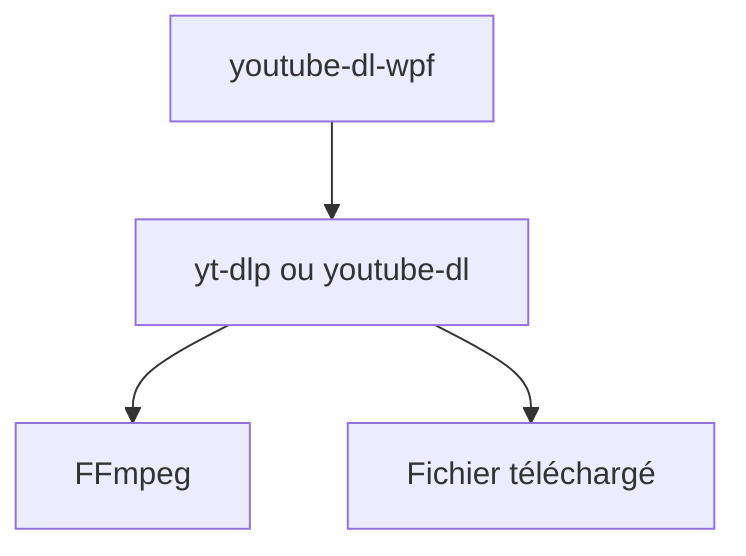

# database64128/youtube-dl-wpf

> Windows (WPF) graphical interface for youtube-dl and yt-dlp.

## The problem
yt-dlp has many command-line options to remember.

## What it actually does
Wraps youtube-dl or yt-dlp: format list, audio and video selection, subtitles, thumbnails, metadata, playlists, proxy, FFmpeg path, output template, free-form arguments. Updates the downloader at startup. No downloader is bundled.

## How it is wired
Simplified diagram based on the sheet, no diagram provided.


## Trying it
```bash
dotnet build -c Release
dotnet publish YoutubeDl.Wpf -c Release
dotnet publish YoutubeDl.Wpf -c Release -r win-x64 --self-contained
```

## Cost and gotchas
Free. You must download yt-dlp yourself and ideally FFmpeg. The non-self-contained binary requires .NET. Playlist bugs come from upstream.

## What it is not
Not a downloader: just a wrapper. WPF implies Windows. Parallel downloading (v2.0) does not exist yet.

## Alternatives
- yt-dlp and youtube-dl on the command line: no interface, but direct.

## For you
Ignore: a Windows utility unrelated to data / AI / MLOps work.
