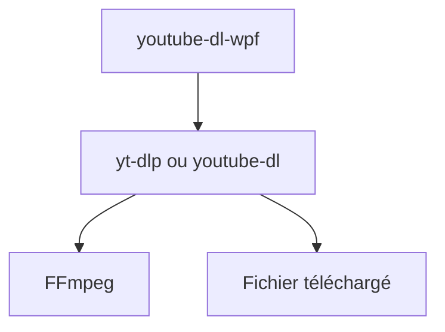

# database64128/youtube-dl-wpf

> Interface graphique Windows (WPF) pour youtube-dl et yt-dlp.

## Le problème
Les options en ligne de commande de yt-dlp sont nombreuses à retenir.

## Ce que ça fait vraiment
Habille youtube-dl ou yt-dlp : liste des formats, choix audio et vidéo, sous-titres, vignettes, métadonnées, playlists, proxy, chemin FFmpeg, modèle de sortie, arguments libres. Met à jour le téléchargeur au démarrage. Aucun téléchargeur n'est fourni.

## Comment c'est branché
Schéma simplifié d'après la fiche, sans diagramme fourni.


## Essayer
```bash
dotnet build -c Release
dotnet publish YoutubeDl.Wpf -c Release
dotnet publish YoutubeDl.Wpf -c Release -r win-x64 --self-contained
```

## Coût et pièges
Gratuit. Il faut télécharger soi-même yt-dlp et idéalement FFmpeg. Le binaire non autonome demande .NET. Les bugs de playlist viennent de l'amont.

## Ce que ce n'est pas
Pas un téléchargeur : un simple wrapper. WPF implique Windows. Le téléchargement parallèle (v2.0) n'existe pas encore.

## Alternatives
- yt-dlp et youtube-dl en ligne de commande : sans interface, mais directs.

## Pour toi
À ignorer : utilitaire Windows sans rapport avec le travail data / IA / MLOps.

