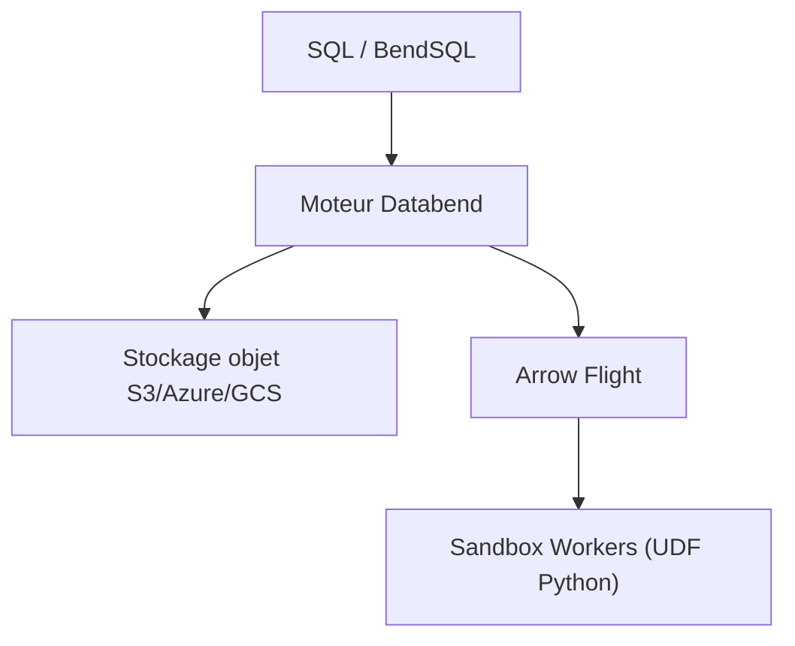

# databendlabs/databend

> Open-source data warehouse in Rust unifying SQL, vector search and full-text search for AI agents.

## The problem
Analytics, search and agent workloads run on separate systems that have to be kept in sync.

## What it actually does
Vectorized warehouse on object storage (S3, Azure, GCS) with an inverted index, a vector index, transactions, Git-style data branches and sandboxed Python UDFs for agent logic, orchestrated in SQL. The benchmarks cited (against Snowflake) are published by the vendor on Databend Cloud.

## How it is wired

Diagram deduced from the "Agent-Ready Architecture" section of the README.

## Trying it
```bash
docker run -d -p 127.0.0.1:8000:8000 datafuselabs/databend
bendsql -u root
```

## Cost and gotchas
Self-hosted is free; Databend Cloud is the recommended option. Object storage and credentials are on you.

## What it is not
Not a general-purpose transactional database. The performance figures come from the vendor and should be reproduced.

## Alternatives
Snowflake is cited as a point of comparison.

## For you
Keep an eye on it: a warehouse with vector and full-text search is useful for RAG and feature engineering; test it on your own data before migrating.
