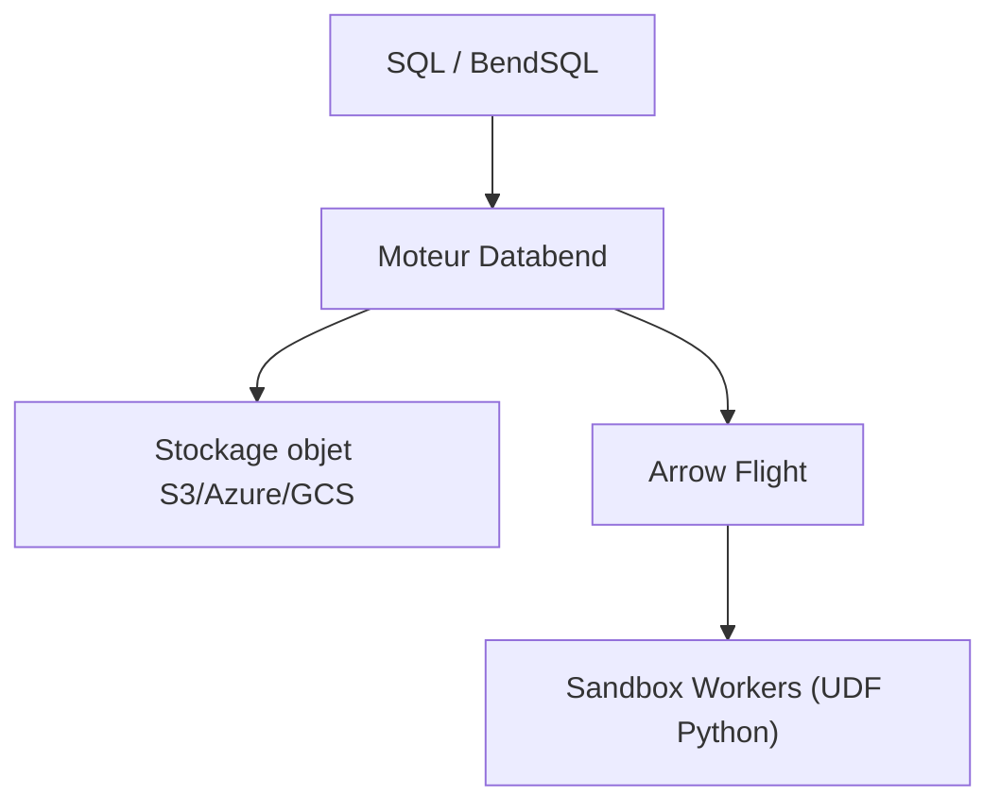

# databendlabs/databend

> Entrepôt de données open source en Rust unifiant SQL, recherche vectorielle et plein texte pour agents IA.

## Le problème
Analytique, recherche et charges d'agents tournent sur des systèmes séparés qu'il faut synchroniser.

## Ce que ça fait vraiment
Entrepôt vectorisé sur stockage objet (S3, Azure, GCS) avec index inversé, index vectoriel, transactions, branches de données façon Git et UDF Python en bac à sable pour la logique d'agent, orchestrée en SQL. Les benchmarks cités (contre Snowflake) sont publiés par l'éditeur sur Databend Cloud.

## Comment c'est branché

Schéma déduit de la section « Agent-Ready Architecture » du README.

## Essayer
```bash
docker run -d -p 127.0.0.1:8000:8000 datafuselabs/databend
bendsql -u root
```

## Coût et pièges
Auto-hébergé gratuit ; Databend Cloud est l'option recommandée. Le stockage objet et les identifiants sont à ta charge.

## Ce que ce n'est pas
Pas une base transactionnelle générale. Les chiffres de performance viennent de l'éditeur, à reproduire.

## Alternatives
Snowflake est cité comme point de comparaison.

## Pour toi
Surveiller : un entrepôt avec vecteur et plein texte est utile pour RAG et feature engineering, à tester sur tes données avant de migrer.

