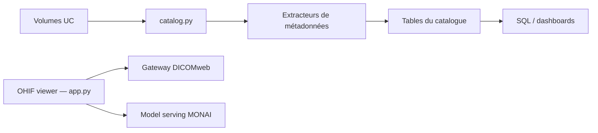

# databricks-industry-solutions/pixels

> Databricks accelerator to catalog DICOM images, analyze them in SQL and segment them with MONAI.

## The problem
Millions of DICOM files are hard to index, protect (health data) and use in SQL or AI.

## What it actually does
The `dbx.pixels` library indexes DICOM files (batch or Auto Loader streaming), extracts metadata into Unity Catalog tables, and can anonymize tags with format-preserving encryption. Databricks apps provide an OHIF viewer, a DICOMweb server (QIDO/WADO/STOW) and MONAI/Vista3D segmentation on serverless GPU, with NIfTI overlays. Installation through Databricks Asset Bundles.

## How it is wired


## Trying it
```python
from dbx.pixels import Catalog
from dbx.pixels.dicom import *
catalog = Catalog(spark)
catalog_df = catalog.catalog(<path>)
meta_df = DicomMetaExtractor(catalog).transform(catalog_df)
catalog.save(meta_df)
```

## Cost and gotchas
A Databricks workspace is mandatory (Unity Catalog, Lakebase, SQL warehouse, GPU for serving). Full installation: 30 to 45 minutes according to the README. Pixel redaction is still being integrated.

## What it is not
Not a standalone tool nor purely open source: Databricks license pointing to their own text, not identified by GitHub. No NIfTI output (on the roadmap).

## Alternatives
No alternative named in the README.

## For you
Worth watching: a solid reference if you work on medical imaging on Databricks, to be dismissed outside that ecosystem, and the license must be read before any use.
