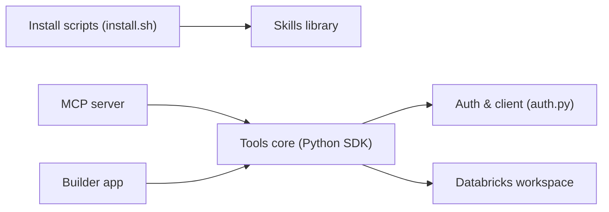

# databricks-solutions/ai-dev-kit

> Installation and tooling kit for using coding agents on Databricks, for data engineers.

## The problem
Coding agents know Databricks patterns poorly (pipelines, Unity Catalog, jobs, MLflow).

## What it actually does
The README announces that the skills are now provided by the official "Databricks AI Tools" (`databricks aitools install`); the copies in this repo are deprecated. What remains: the installer, an MCP server (40+ tools, best-effort maintained), `databricks-tools-core` (Python library: SQL, jobs, catalog…) and a Builder App (FastAPI + React) deployable on Databricks Apps. A `.test/` harness evaluates the skills.

## How it is wired


## Trying it
```bash
bash <(curl -sL https://raw.githubusercontent.com/databricks-solutions/ai-dev-kit/main/install.sh)
databricks aitools install
cd ai-dev-kit/databricks-builder-app
./scripts/start_local.sh --profile <your-profile>
```

## Cost and gotchas
Databricks workspace and CLI v1.0.0+ required; the Builder App provisions Lakebase. The README is truncated at the final table (components cut off).

## What it is not
It is no longer the source of the skills: they live elsewhere. The MCP is only maintained on a best-effort basis; the repo mainly serves as an entry point.

## Alternatives
- databricks/databricks-agent-skills: official source of the skills.
- mlflow/skills: MLflow skills.
- databricks-solutions/apx: FastAPI + React framework for Apps.

## For you
Worth watching: useful if you work on Databricks, but better to go directly through `databricks aitools` than through this kit in transition.
