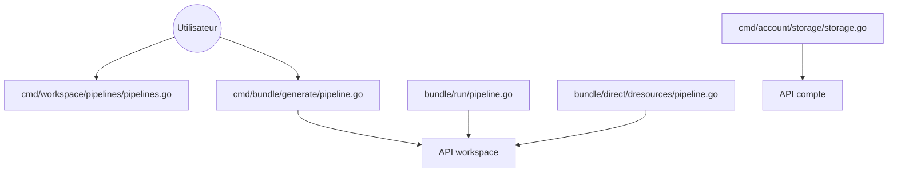

# databricks/cli

> Official Databricks command line: workspace operations and bundle deployment.

## The problem
Driving Databricks and deploying your pipelines by hand from the interface is slow and hard to reproduce.

## What it actually does
A dependency-free binary that calls the workspace and account APIs (pipelines, storage, feature engineering) and manages Databricks Asset Bundles: define, generate, deploy, run a pipeline and follow its updates. Stability policy and semantic versioning are documented; Beta or `experimental` commands are unstable. Unified Databricks authentication.

## How it is wired


## Trying it
```bash
docker pull ghcr.io/databricks/cli:latest
docker run -e DATABRICKS_HOST=$YOUR_HOST_URL -e DATABRICKS_TOKEN=$YOUR_TOKEN ghcr.io/databricks/cli:latest current-user me
```

## Cost and gotchas
Requires a Databricks workspace (billed) and a token. Use is subject to the Databricks license and privacy notice, with provisions on usage data. License not recognized by GitHub. 434 open issues.

## What it is not
Not a tool independent of Databricks: useless without their platform. Only the pipeline flow is established in the diagram.

## Alternatives
No alternative named in the README.

## For you
Adopt if you work on Databricks: it is the official tool to automate pipelines and MLOps deployments; otherwise irrelevant.
