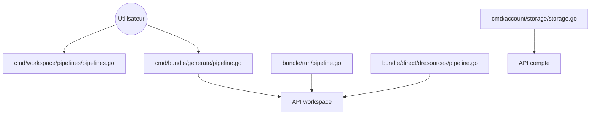

# databricks/cli

> Ligne de commande officielle de Databricks : opérations sur l'espace de travail et déploiement de bundles.

## Le problème
Piloter Databricks et déployer ses pipelines à la main depuis l'interface est lent et peu reproductible.

## Ce que ça fait vraiment
Binaire sans dépendance qui appelle les API workspace et compte (pipelines, stockage, feature engineering) et gère les Databricks Asset Bundles : définir, générer, déployer, lancer un pipeline et suivre les mises à jour. Politique de stabilité et versionnage sémantique documentés ; commandes Beta ou `experimental` instables. Authentification unifiée Databricks.

## Comment c'est branché


## Essayer
```bash
docker pull ghcr.io/databricks/cli:latest
docker run -e DATABRICKS_HOST=$YOUR_HOST_URL -e DATABRICKS_TOKEN=$YOUR_TOKEN ghcr.io/databricks/cli:latest current-user me
```

## Coût et pièges
Exige un espace de travail Databricks (facturé) et un jeton. Utilisation soumise à la licence et à l'avis de confidentialité Databricks, avec dispositions sur les données d'usage. Licence non reconnue par GitHub. 434 issues ouvertes.

## Ce que ce n'est pas
Pas un outil indépendant de Databricks : inutile sans leur plateforme. Seul le flux des pipelines est établi dans le diagramme.

## Alternatives
Aucune alternative nommée dans le README.

## Pour toi
Adopter si tu travailles sur Databricks : c'est l'outil officiel pour automatiser pipelines et déploiements MLOps ; sinon sans objet.

