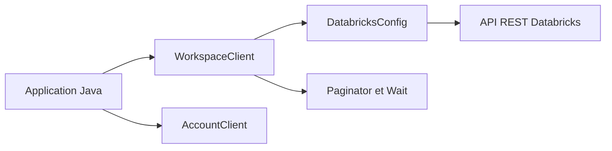

# databricks/databricks-sdk-java

> Java SDK to drive the Databricks REST APIs (workspace and account), for JVM developers.

## The problem
Calling the Databricks REST APIs by hand means handling authentication, pagination, retries and long-running operations.

## What it actually does
Provides `WorkspaceClient` and `AccountClient` covering the public operations. Authentication follows a default chain (token, Azure, Google Cloud, OAuth) with cloud detection. Long-running operations return a `Wait` object, pagination is hidden by a `Paginator`, and transient errors (429, 503) are retried. The announced status is Beta.

## How it is wired


## Trying it
```bash
# pom.xml
# <dependency>
#   <groupId>com.databricks</groupId>
#   <artifactId>databricks-sdk-java</artifactId>
#   <version>0.0.1</version>
# </dependency>
```

## Cost and gotchas
A Databricks workspace and credentials are needed. Java 8 or later is required (Maven): a need outside the list, hence `none` as prerequisite. The README gives version 0.0.1, to be verified.

## What it is not
It is not a Python client: the README cites the Python and Go SDKs as equivalents. It provides no access without a Databricks account.

## Alternatives
- Databricks SDK for Python: preferable for data science use.
- Databricks SDK for Go: for tools written in Go.

## For you
Worth watching: keep in mind if you integrate Databricks into JVM services; for notebooks or Python MLOps, take the Python SDK instead.
