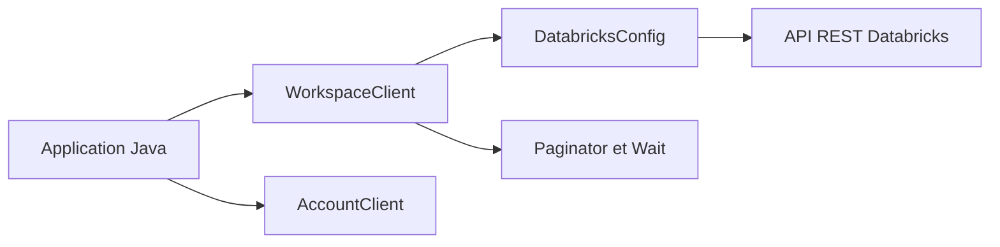

# databricks/databricks-sdk-java

> SDK Java pour piloter les API REST de Databricks (espace de travail et compte), pour développeurs JVM.

## Le problème
Appeler à la main les API REST de Databricks oblige à gérer l'authentification, la pagination, les retries et les opérations longues.

## Ce que ça fait vraiment
Fournit `WorkspaceClient` et `AccountClient` couvrant les opérations publiques. L'authentification suit une chaîne par défaut (jeton, Azure, Google Cloud, OAuth) avec détection du cloud. Les opérations longues renvoient un objet `Wait`, la pagination est cachée par un `Paginator`, et les erreurs transitoires (429, 503) sont réessayées. Le statut annoncé est Beta.

## Comment c'est branché


## Essayer
```bash
# pom.xml
# <dependency>
#   <groupId>com.databricks</groupId>
#   <artifactId>databricks-sdk-java</artifactId>
#   <version>0.0.1</version>
# </dependency>
```

## Coût et pièges
Un espace de travail Databricks et des identifiants sont nécessaires. Java 8 ou plus est requis (Maven) : besoin hors liste, d'où `aucun` en prérequis. Le README donne la version 0.0.1, à vérifier.

## Ce que ce n'est pas
Ce n'est pas un client Python : le README cite les SDK Python et Go comme équivalents. Il ne fournit aucun accès sans compte Databricks.

## Alternatives
- Databricks SDK for Python : préférable pour un usage data science.
- Databricks SDK for Go : pour les outils en Go.

## Pour toi
À surveiller : à retenir si tu intègres Databricks à des services JVM ; pour des notebooks ou du MLOps en Python, prends plutôt le SDK Python.

