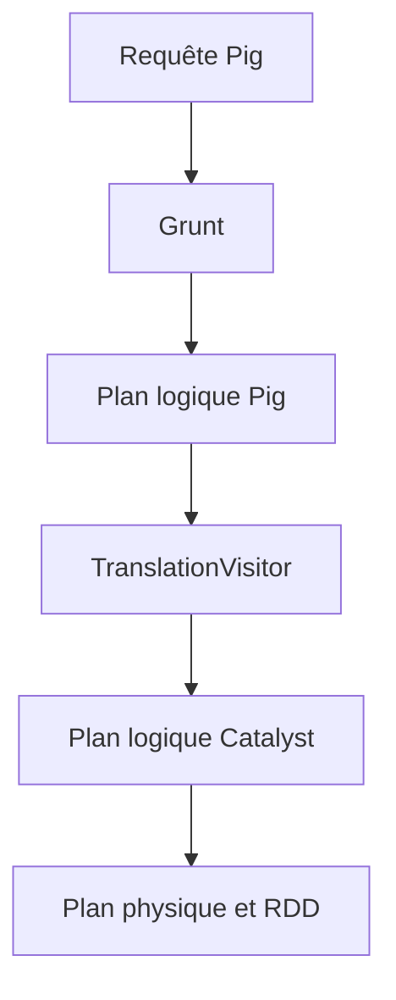

# databricks/pig-on-spark

> Proof of concept running Pig queries on Spark SQL via Catalyst, for the migration-curious.

## The problem
Existing Pig scripts do not run on Spark.

## What it actually does
Translates the Pig logical plan into a Catalyst logical plan, using visitors (`LogicalPlanTranslationVisitor`, `ExpressionPlanTranslationVisitor`, `NestedPlanTranslationVisitor`), then lets Catalyst optimize and execute. Used through `SQLContext.pql(query)`. Known limits: no CoGroup on several tables, no custom load functions, only SUM, MIN, MAX and AVG are handled.

## How it is wired
Simplified diagram based on the fiche, no diagram provided.



## Trying it
```bash
ant mvn-install
$SPARK_HOME/sbt/sbt assembly
sbt/sbt "test-only org.apache.spark.sql.PigCompatibilitySuite"
```

## Cost and gotchas
Pig and Spark must be compiled together and the Spark SQL `pom.xml` modified. The README flags a tolerated build error. Intended for 2014 versions.

## What it is not
Not a production solution: the README states that Sigmoid's integration, at the physical node level, was preferred.

## Alternatives
Sigmoid's Pig-on-Spark solution, cited in the README.

## For you
Ignore: a 2014 proof of concept, archived, and Pig is no longer a common migration target.
