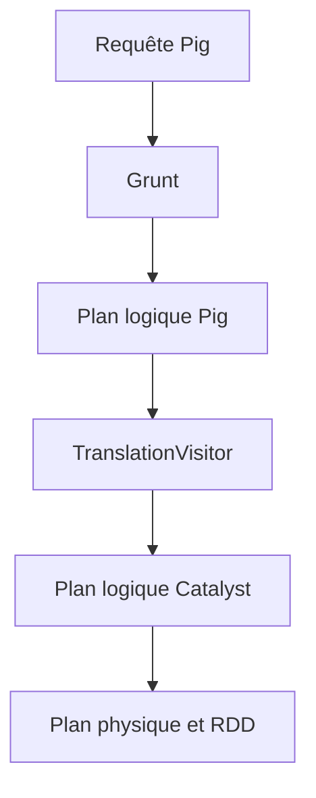

# databricks/pig-on-spark

> Preuve de concept exécutant des requêtes Pig sur Spark SQL via Catalyst, pour curieux de migration.

## Le problème
Des scripts Pig existants ne tournent pas sur Spark.

## Ce que ça fait vraiment
Traduit le plan logique de Pig en plan logique Catalyst, à l'aide de visiteurs (`LogicalPlanTranslationVisitor`, `ExpressionPlanTranslationVisitor`, `NestedPlanTranslationVisitor`), puis laisse Catalyst optimiser et exécuter. S'utilise par `SQLContext.pql(query)`. Limites connues : pas de CoGroup sur plusieurs tables, pas de fonctions de chargement personnalisées, seules SUM, MIN, MAX et AVG sont gérées.

## Comment c'est branché
Schéma simplifié d'après la fiche, sans diagramme fourni.



## Essayer
```bash
ant mvn-install
$SPARK_HOME/sbt/sbt assembly
sbt/sbt "test-only org.apache.spark.sql.PigCompatibilitySuite"
```

## Coût et pièges
Il faut compiler Pig et Spark ensemble et modifier le `pom.xml` de Spark SQL. Le README signale une erreur de build tolérée. Prévu pour des versions de 2014.

## Ce que ce n'est pas
Pas une solution de production : le README annonce que l'intégration de Sigmoid, au niveau des noeuds physiques, était privilégiée.

## Alternatives
La solution Sigmoid de Pig sur Spark, citée dans le README.

## Pour toi
À ignorer : preuve de concept de 2014, archivée, et Pig n'est plus une cible de migration courante.

