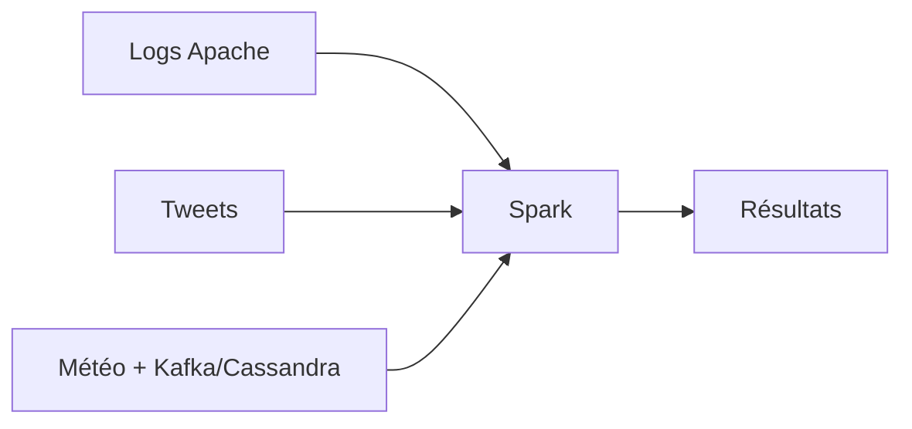

# databricks/reference-apps

> Reference applications for learning Apache Spark by example, based on the Databricks book.

## The problem
Learning Spark without concrete end-to-end examples is slow.

## What it actually does
Three apps: Apache log analysis (Spark SQL, Streaming), a language classifier for tweets (MLlib + Streaming), weather time series with Cassandra and Kafka. Build instructions for the classifier are in `twitter_classifier/scala/README.md`.

## How it is wired

## Trying it
No command documented in this README; see `twitter_classifier/scala/README.md`.

## Cost and gotchas
Free. Last push October 2024, examples probably tied to old Spark versions (not verified). License present but not identified.

## What it is not
Not a library or a product. The Twitter API cited is an external dependency risk.

## Alternatives
No alternative named in the README.

## For you
Ignore: dated examples; prefer the current Spark documentation to learn.
