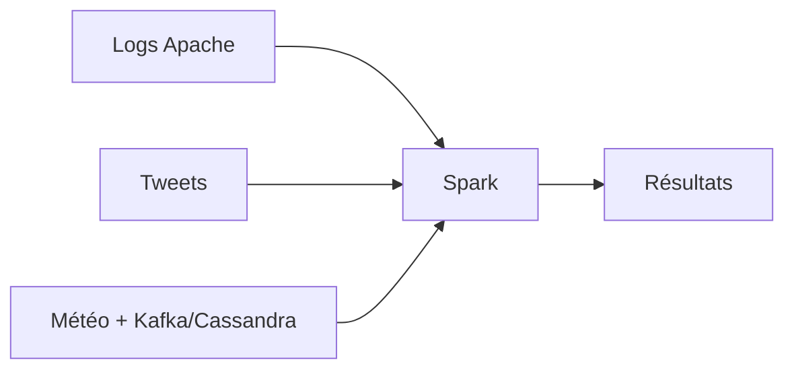

# databricks/reference-apps

> Applications de référence pour apprendre Apache Spark par l'exemple, d'après le livre Databricks.

## Le problème
Apprendre Spark sans exemples concrets de bout en bout est long.

## Ce que ça fait vraiment
Trois applis : analyse de logs Apache (Spark SQL, Streaming), classifieur de langue pour tweets (MLlib + Streaming), séries temporelles météo avec Cassandra et Kafka. Instructions de build pour le classifieur dans `twitter_classifier/scala/README.md`.

## Comment c'est branché

## Essayer
Aucune commande documentée dans ce README ; voir `twitter_classifier/scala/README.md`.

## Coût et pièges
Gratuit. Dernier push octobre 2024, exemples probablement liés à d'anciennes versions de Spark (non vérifié). Licence présente mais non identifiée.

## Ce que ce n'est pas
Pas une bibliothèque ni un produit. L'API Twitter citée est un risque de dépendance externe.

## Alternatives
Aucune alternative nommée dans le README.

## Pour toi
À ignorer : exemples datés ; préfère la documentation Spark actuelle pour apprendre.

