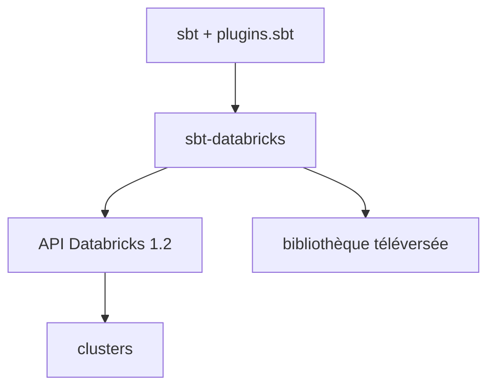

# databricks/sbt-databricks

> sbt plugin to deploy Scala projects to Databricks, now archived.

## The problem
Deploying a Scala library to Databricks clusters meant uploading, attaching and restarting by hand.

## What it actually does
The plugin adds sbt commands: create, resize and delete a cluster (`dbcCreateCluster`...), upload and attach a library (`dbcDeploy`, `dbcUpload`, `dbcAttach`), run a Scala, Python or SQL command on a cluster. Configuration (credentials, API 1.2 URL) goes in the build file.

## How it is wired
Simplified diagram based on the fiche, no diagram provided.


## Trying it
```bash
dev/run-tests
dev/lint
```
```scala
addSbtPlugin("com.databricks" %% "sbt-databricks" % "0.1.5")
```

## Cost and gotchas
A Databricks account is required, with the password in clear text in the configuration (an environment variable is recommended). Last push in 2018, repository archived, old API 1.2. Scala and sbt are required.

## What it is not
Not a tool for current Databricks APIs: it does not handle the /api/2.0 endpoint.

## Alternatives
No alternative named in the README.

## For you
Ignore: archived and tied to an old version of the platform.
