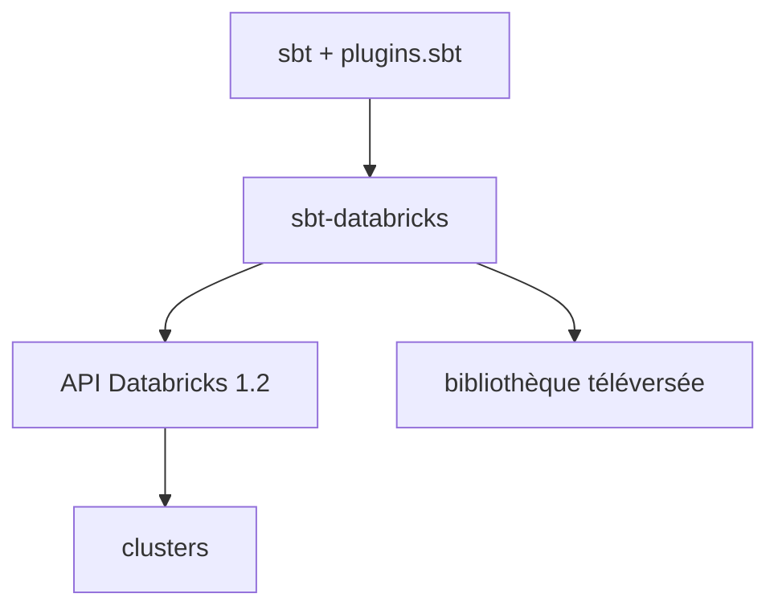

# databricks/sbt-databricks

> Plugin sbt pour déployer des projets Scala sur Databricks, désormais archivé.

## Le problème
Déployer une bibliothèque Scala sur des clusters Databricks demandait de téléverser, attacher et redémarrer à la main.

## Ce que ça fait vraiment
Le plugin ajoute des commandes sbt : créer, redimensionner et supprimer un cluster (`dbcCreateCluster`…), téléverser et attacher une bibliothèque (`dbcDeploy`, `dbcUpload`, `dbcAttach`), lancer une commande Scala, Python ou SQL sur un cluster. La configuration (identifiants, URL d'API 1.2) se place dans le fichier de build.

## Comment c'est branché
Schéma simplifié d'après la fiche, sans diagramme fourni.


## Essayer
```bash
dev/run-tests
dev/lint
```
```scala
addSbtPlugin("com.databricks" %% "sbt-databricks" % "0.1.5")
```

## Coût et pièges
Compte Databricks requis, avec mot de passe en clair dans la configuration (variable d'environnement conseillée). Dernier push en 2018, dépôt archivé, API 1.2 ancienne. Scala et sbt sont nécessaires.

## Ce que ce n'est pas
Pas un outil pour les API actuelles de Databricks : il ne gère pas l'endpoint /api/2.0.

## Alternatives
Aucune alternative nommée dans le README.

## Pour toi
À ignorer : archivé et lié à une version ancienne de la plateforme.

