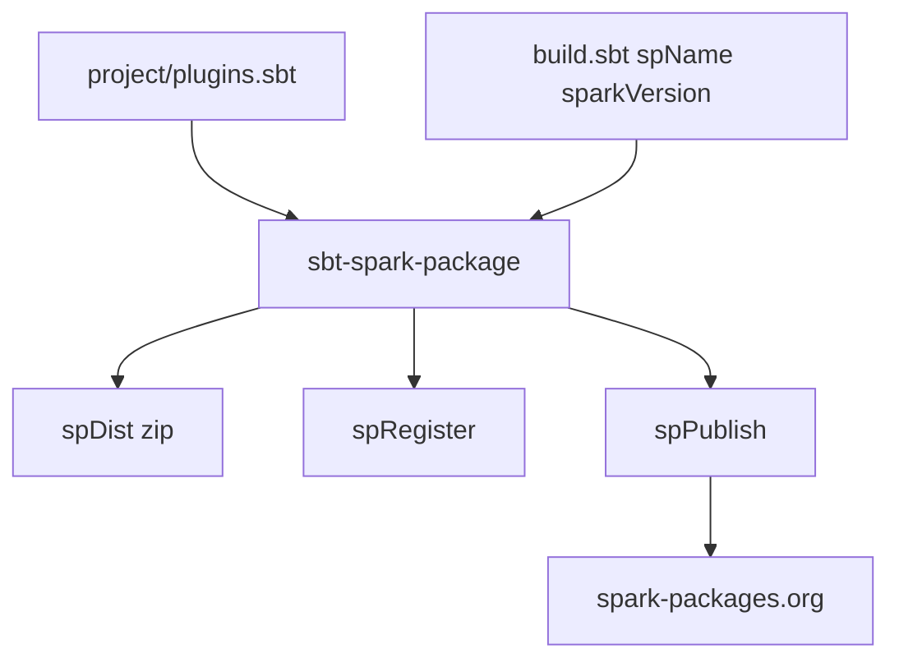

# databricks/sbt-spark-package

> sbt plugin to develop, package and publish Spark Packages, for Scala developers.

## The problem
Publishing a Spark package on the Spark Packages site required many manual steps.

## What it actually does
An sbt plugin that exposes `spName`, `sparkVersion` and `sparkComponents`. It provides `sbt spDist` (zip archive), `spPublishLocal`, `spRegister` and `spPublish`, handles shaded dependencies via sbt-assembly, and opens a Spark context with `sbt console`. Registration requires a GitHub token with `read:org`.

## How it is wired
Simplified diagram based on the sheet, no diagram provided.



## Trying it
```bash
sbt spDist
sbt spPublishLocal
sbt spRegister
sbt spPublish
```

## Cost and gotchas
Free, but you need sbt, a spark-packages.org account and a GitHub token. The Bintray resolver mentioned has been dead for a long time (not verified in the README, but Bintray shut down).

## What it is not
Not a tool for using Spark: it serves to publish packages on a site that has become marginal. Archived since 2018.

## Alternatives
None cited in the README.

## For you
Ignore: plugin for an abandoned publishing ecosystem, archived since 2018.
