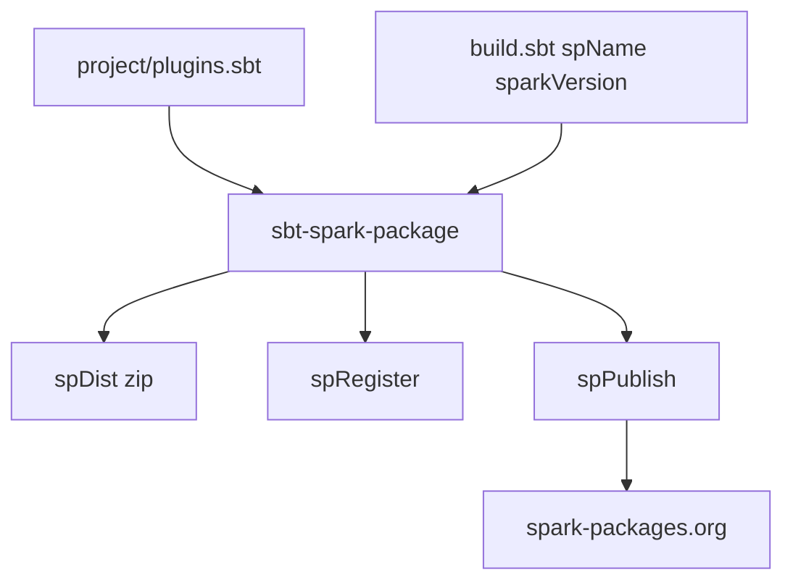

# databricks/sbt-spark-package

> Plugin sbt pour développer, empaqueter et publier des Spark Packages, pour développeurs Scala.

## Le problème
Publier un paquet Spark sur le site Spark Packages demandait de nombreuses étapes manuelles.

## Ce que ça fait vraiment
Un plugin sbt qui expose `spName`, `sparkVersion` et `sparkComponents`. Il fournit `sbt spDist` (archive zip), `spPublishLocal`, `spRegister` et `spPublish`, gère les dépendances ombrées via sbt-assembly, et ouvre un contexte Spark avec `sbt console`. L'enregistrement exige un jeton GitHub avec `read:org`.

## Comment c'est branché
Schéma simplifié d'après la fiche, sans diagramme fourni.



## Essayer
```bash
sbt spDist
sbt spPublishLocal
sbt spRegister
sbt spPublish
```

## Coût et pièges
Gratuit, mais il faut sbt, un compte spark-packages.org et un jeton GitHub. Le résolveur Bintray indiqué est mort depuis longtemps (non vérifié dans le README, mais Bintray a fermé).

## Ce que ce n'est pas
Pas un outil pour utiliser Spark : il sert à publier des paquets sur un site devenu marginal. Archivé depuis 2018.

## Alternatives
Aucune citée dans le README.

## Pour toi
À ignorer : plugin d'un écosystème de publication abandonné, archivé depuis 2018.

