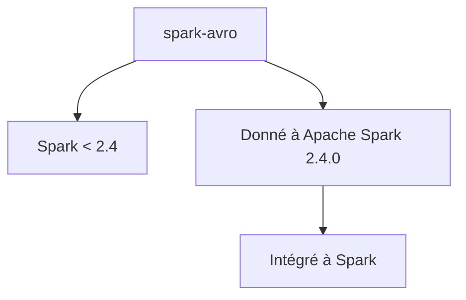

# databricks/spark-avro

> Former Avro data source for Apache Spark, now built into Spark itself.

## The problem
Reading and writing the Avro format in Spark required an external library before Spark 2.4.

## What it actually does
The README is very short (insufficient material): Databricks donated this library to the Apache Spark project starting with Spark 2.4.0. Databricks customers can use it without any extra dependency. For versions before 2.4, the README points to the old README file.

## How it is wired
Simplified diagram based on the sheet; no diagram was provided.

## Trying it
No command documented in the README: the repository points to Spark 2.4+ where the feature is built in.

## Cost and gotchas
Free. Archived repository, last push in 2018: do not add it to a recent project.

## What it is not
Not the library to use today: it now lives in Apache Spark. No usage documentation in this repository.

## Alternatives
No alternative named, other than the Avro module built into Apache Spark since 2.4.0.

## For you
Ignore: obsolete and archived; use Spark's native Avro support.
