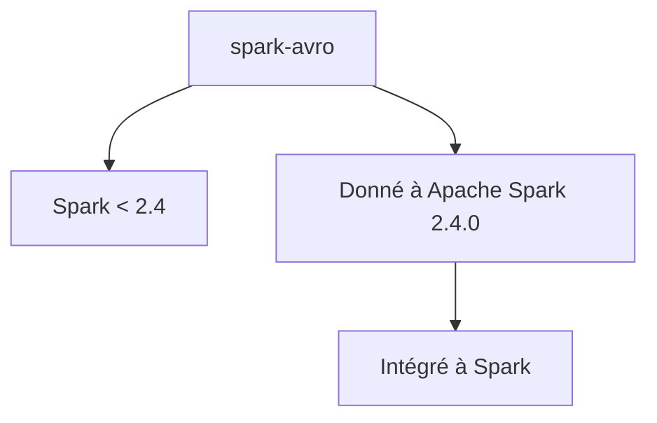

# databricks/spark-avro

> Ancienne source de données Avro pour Apache Spark, désormais intégrée à Spark lui-même.

## Le problème
Lire et écrire du format Avro dans Spark nécessitait une bibliothèque externe avant Spark 2.4.

## Ce que ça fait vraiment
Le README est très court (matière insuffisante) : Databricks a donné cette bibliothèque au projet Apache Spark à partir de Spark 2.4.0. Les clients Databricks peuvent l'utiliser sans dépendance supplémentaire. Pour les versions antérieures à 2.4, le README renvoie à l'ancien fichier README.

## Comment c'est branché
Schéma simplifié d'après la fiche, sans diagramme fourni.

## Essayer
Aucune commande documentée dans le README : le dépôt renvoie à Spark 2.4+ où la fonction est intégrée.

## Coût et pièges
Gratuit. Dépôt archivé, dernier push en 2018 : ne l'ajoute pas à un projet récent.

## Ce que ce n'est pas
Pas la bibliothèque à utiliser aujourd'hui : elle vit désormais dans Apache Spark. Pas de documentation d'usage dans ce dépôt.

## Alternatives
Aucune alternative nommée, sinon le module Avro intégré à Apache Spark depuis la 2.4.0.

## Pour toi
À ignorer : obsolète et archivé ; utilise la prise en charge Avro native de Spark.

