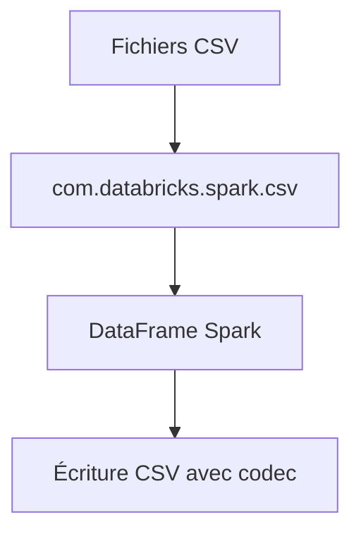

# databricks/spark-csv

> CSV data source for Spark 1.x, now built into Spark 2, for data engineers on older versions.

## The problem
Spark 1.x could not natively read CSV files into DataFrames.

## What it actually does
- Reads and writes CSVs into DataFrames with header, delimiter, quotes, escaping and compression codec.
- Three read modes: PERMISSIVE, DROPMALFORMED and FAILFAST.
- Optional schema inference, at the cost of an extra pass over the data.
- SQL, Scala, Java, Python and R APIs.

## How it is wired
Simplified diagram based on the sheet, no diagram provided.


## Trying it
```bash
$SPARK_HOME/bin/spark-shell --packages com.databricks:spark-csv_2.11:1.5.0
sbt/sbt package
```

## Cost and gotchas
Free, but it needs Spark 1.3 or later and Scala; the build goes through SBT and Java (not listed in the prerequisites).

## What it is not
Not to be used with Spark 2 or later: the feature is built into Spark. Repository archived since 2018.

## Alternatives
No alternative named; the README only states that Spark 2.x includes it.

## For you
Ignore: built into Spark 2 for a long time; only of interest for maintaining old Spark 1 code.
