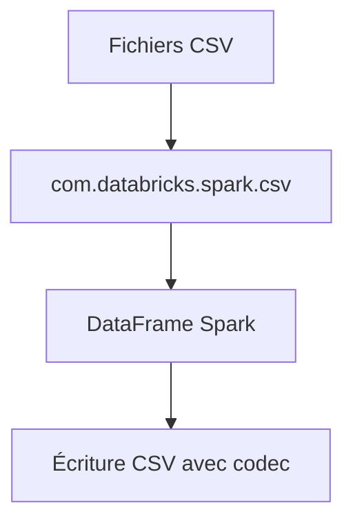

# databricks/spark-csv

> Source de données CSV pour Spark 1.x, aujourd'hui intégrée à Spark 2, pour ingénieurs data sur anciennes versions.

## Le problème
Spark 1.x ne lisait pas nativement les fichiers CSV en DataFrames.

## Ce que ça fait vraiment
- Lit et écrit des CSV en DataFrames avec en-tête, délimiteur, guillemets, échappement et codec de compression.
- Trois modes de lecture : PERMISSIVE, DROPMALFORMED et FAILFAST.
- Inférence de schéma en option, au prix d'un passage supplémentaire sur les données.
- API SQL, Scala, Java, Python et R.

## Comment c'est branché
Schéma simplifié d'après la fiche, sans diagramme fourni.


## Essayer
```bash
$SPARK_HOME/bin/spark-shell --packages com.databricks:spark-csv_2.11:1.5.0
sbt/sbt package
```

## Coût et pièges
Gratuit, mais il faut Spark 1.3 ou plus et Scala ; la compilation passe par SBT et Java (non listés dans les prérequis).

## Ce que ce n'est pas
Pas à utiliser avec Spark 2 ou plus : la fonction est intégrée à Spark. Dépôt archivé depuis 2018.

## Alternatives
Aucune alternative nommée ; le README indique seulement que Spark 2.x l'inclut.

## Pour toi
À ignorer : intégré à Spark 2 depuis longtemps ; n'a d'intérêt que pour maintenir un vieux code Spark 1.

