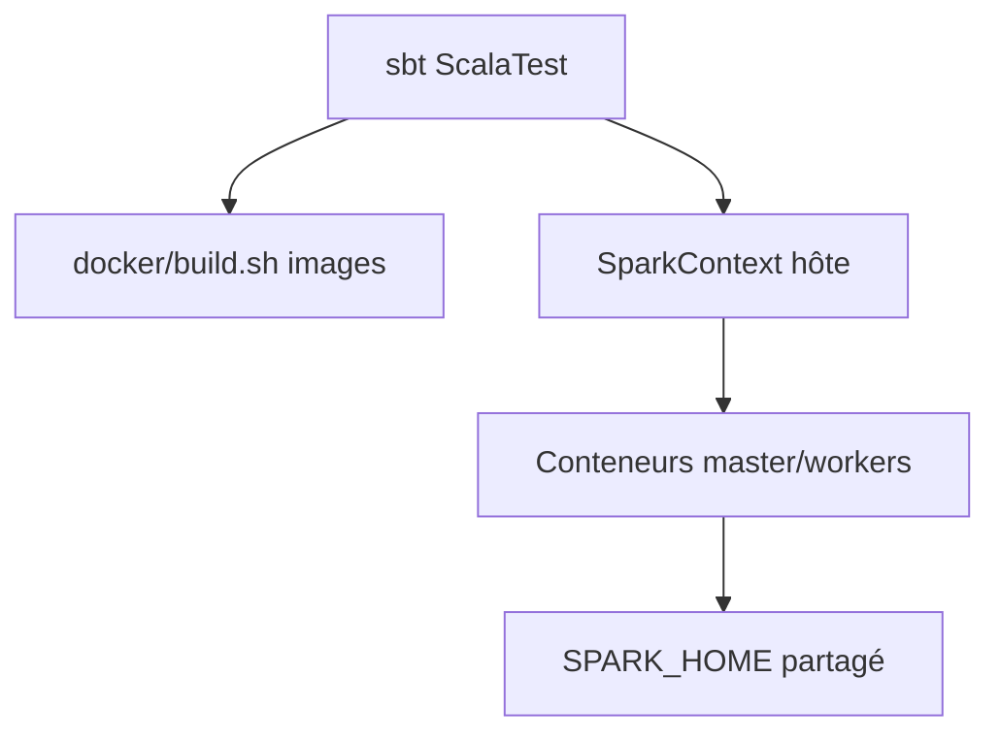

# databricks/spark-integration-tests

> Spark integration tests under Docker, including standalone manager fault tolerance, for Spark maintainers.

## The problem
Checking Spark's behaviour on a real cluster (master failures, Mesos) requires reproducible environments.

## What it actually does
ScalaTest suites launched by sbt, which start Docker containers to test Spark, notably standalone mode and Mesos. The `SPARK_HOME` of a built Spark checkout is shared with the containers. `init.sh` checks the environment.

## How it is wired


## Trying it
```bash
./docker/build.sh
./init.sh
sbt -mem 2048 test:package "test-only org.apache.spark.integrationtests.MesosSuite"
```

## Cost and gotchas
Free. Docker >= 1.3.0 without sudo, a built Spark checkout, large image downloads. For Mesos: `MESOS_NATIVE_LIBRARY`. Last push in 2023: outdated boot2docker instructions.

## What it is not
Not a tool for testing your Spark jobs. And `docker kill $(docker ps -q)` kills all containers, not just those of the tests.

## Alternatives
None named in the README.

## For you
Ignore: reserved for Spark developers, old and unrelated to using Spark in data engineering.
