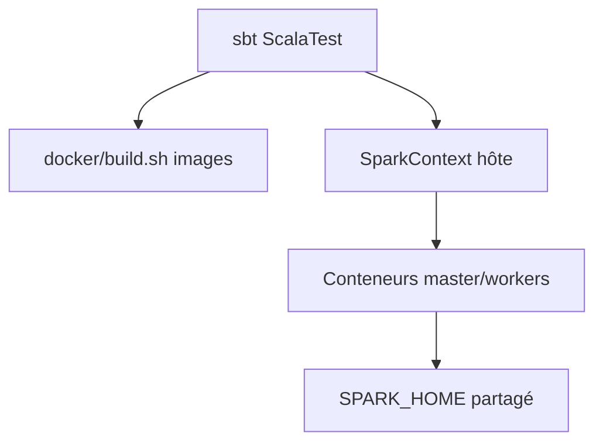

# databricks/spark-integration-tests

> Tests d'intégration de Spark sous Docker, dont la tolérance aux pannes du gestionnaire standalone, pour mainteneurs de Spark.

## Le problème
Vérifier le comportement de Spark en cluster réel (pannes de master, Mesos) demande des environnements reproductibles.

## Ce que ça fait vraiment
Suites ScalaTest lancées par sbt, qui démarrent des conteneurs Docker pour tester Spark, notamment le mode standalone et Mesos. Le `SPARK_HOME` d'un checkout Spark compilé est partagé avec les conteneurs. `init.sh` vérifie l'environnement.

## Comment c'est branché


## Essayer
```bash
./docker/build.sh
./init.sh
sbt -mem 2048 test:package "test-only org.apache.spark.integrationtests.MesosSuite"
```

## Coût et pièges
Gratuit. Docker >= 1.3.0 sans sudo, checkout Spark compilé, gros téléchargement d'images. Pour Mesos : `MESOS_NATIVE_LIBRARY`. Dernier push en 2023 : instructions boot2docker datées.

## Ce que ce n'est pas
Pas un outil pour tester tes jobs Spark. Et `docker kill $(docker ps -q)` tue tous les conteneurs, pas seulement ceux des tests.

## Alternatives
Aucune nommée dans le README.

## Pour toi
Ignorer : réservé aux développeurs de Spark, ancien et sans lien avec l'usage de Spark en data engineering.

