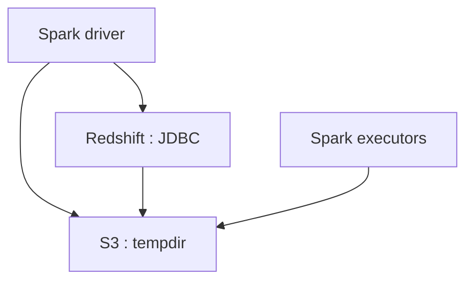

# databricks/spark-redshift

> Spark connector to read and write Amazon Redshift tables via S3, replaced by Databricks Runtime.

## The problem
Loading large volumes from Redshift into Spark DataFrames, and back, without going through JDBC row by row.

## What it actually does
The library triggers `COPY` and `UNLOAD` commands on Redshift via JDBC, and moves the data through S3 (Avro format by default, CSV optional). It exposes Scala, Python, SQL and R APIs. It does not clean up temporary S3 files.

## How it is wired


## Trying it
```bash
# Dépendance Maven documentée (pas de commande shell) :
# groupId: com.databricks
# artifactId: spark-redshift_2.11
# version: 3.0.0-preview1
```

## Cost and gotchas
You need a Redshift cluster, an S3 bucket (plan an expiration rule) and a JDBC driver. Credentials may pass through the JDBC query: enable SSL. Last push in August 2023; Spark 2.0+ required.

## What it is not
No longer maintained separately: the README states the connector is built into Databricks Runtime (3.0+), with query pushdown. It suits ETL, not interactive queries.

## Alternatives
No alternative named as a repo; the README points to the connector built into Databricks Runtime.

## For you
Ignore: no separate releases since Databricks Runtime 3.0 and last push in 2023, so a maintenance trap.
