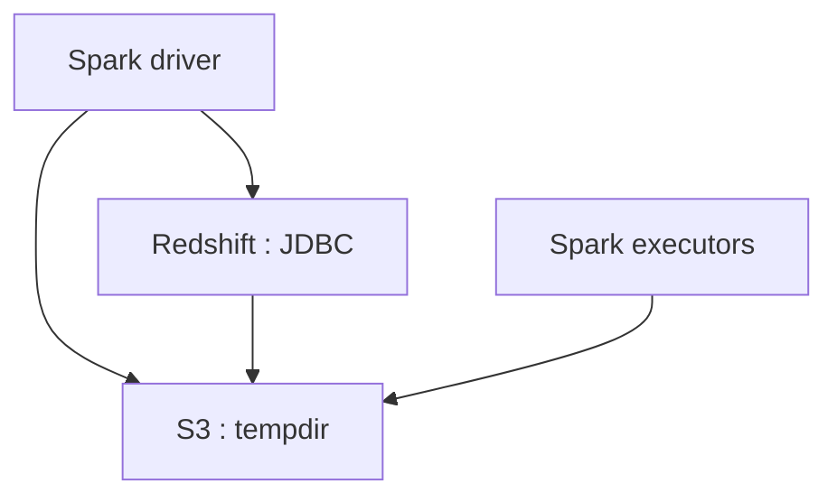

# databricks/spark-redshift

> Connecteur Spark pour lire et écrire des tables Amazon Redshift via S3, remplacé par Databricks Runtime.

## Le problème
Charger de gros volumes de Redshift vers des DataFrames Spark, et inversement, sans passer par JDBC ligne à ligne.

## Ce que ça fait vraiment
La bibliothèque déclenche des commandes `COPY` et `UNLOAD` sur Redshift via JDBC, et transite les données par S3 (format Avro par défaut, CSV en option). Elle expose les API Scala, Python, SQL et R. Elle ne nettoie pas les fichiers temporaires S3.

## Comment c'est branché


## Essayer
```bash
# Dépendance Maven documentée (pas de commande shell) :
# groupId: com.databricks
# artifactId: spark-redshift_2.11
# version: 3.0.0-preview1
```

## Coût et pièges
Il faut un cluster Redshift, un bucket S3 (prévoir une règle d'expiration) et un pilote JDBC. Les identifiants peuvent passer dans la requête JDBC : activer SSL. Dernier push en août 2023 ; Spark 2.0+ requis.

## Ce que ce n'est pas
Ce n'est plus maintenu séparément : le README indique que le connecteur est intégré à Databricks Runtime (3.0+), avec pushdown de requêtes. Il convient à l'ETL, pas aux requêtes interactives.

## Alternatives
Aucune alternative nommée sous forme de dépôt ; le README renvoie au connecteur intégré à Databricks Runtime.

## Pour toi
Ignorer : plus de versions séparées depuis Databricks Runtime 3.0 et dernier push en 2023, donc piège de maintenance.

