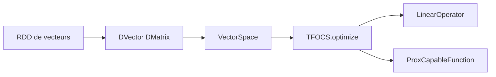

# databricks/spark-tfocs

> Scala port of TFOCS for solving distributed convex optimization problems on Spark.

## The problem
Solving lasso or linear programs on large volumes requires a solver that runs on a Spark cluster.

## What it actually does
It provides `SolverL1RLS` (lasso), `SolverSLP` (smoothed linear program), `TFOCS` (general convex solver) and `TFOCS_SCD`. Distributed vectors and matrices are RDDs of `DenseVector` and `Vector`. The names follow those of TFOCS for Matlab.

## How it is wired
Simplified diagram based on the fiche, no diagram provided.



## Trying it
```scala
SolverL1RLS.run(A, b, lambda)
SolverSLP.run(c, A, b, mu)
```
Installation commands are not documented. Spark and Scala are required, not in the prerequisites list.

## Cost and gotchas
It needs a Spark cluster compatible with the MLlib API of the time. Last push in April 2024, open TODOs (block storage, sparse vectors).

## What it is not
It is not a tool guaranteed to work with recent Spark: the README gives no version. It only serves convex optimization.

## Alternatives
No alternative named in the README, except TFOCS for Matlab, whose names it reuses.

## For you
Ignore: nearly abandoned and tied to an old Spark MLlib API; reconsider it only if you must reproduce TFOCS on Spark.
