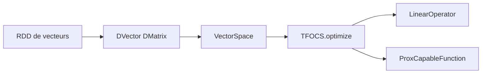

# databricks/spark-tfocs

> Port Scala de TFOCS pour résoudre des problèmes d'optimisation convexe distribués sur Spark.

## Le problème
Résoudre lasso ou programmes linéaires sur de gros volumes demande un solveur qui tourne sur un cluster Spark.

## Ce que ça fait vraiment
Il fournit `SolverL1RLS` (lasso), `SolverSLP` (programme linéaire lissé), `TFOCS` (solveur convexe général) et `TFOCS_SCD`. Les vecteurs et matrices distribués sont des RDD de `DenseVector` et `Vector`. Les noms suivent ceux de TFOCS pour Matlab.

## Comment c'est branché
Schéma simplifié d'après la fiche, sans diagramme fourni.



## Essayer
```scala
SolverL1RLS.run(A, b, lambda)
SolverSLP.run(c, A, b, mu)
```
Commandes d'installation non documentées. Un Spark et Scala sont nécessaires, hors liste de prérequis.

## Coût et pièges
Il faut un cluster Spark compatible avec l'API MLlib de l'époque. Dernier push en avril 2024, TODO ouverts (stockage par blocs, vecteurs creux).

## Ce que ce n'est pas
Ce n'est pas un outil pour Spark récent garanti : le README ne donne aucune version. Il ne sert qu'à l'optimisation convexe.

## Alternatives
Aucune alternative nommée dans le README, sauf TFOCS pour Matlab dont il reprend les noms.

## Pour toi
Ignorer : quasi abandonné et lié à une ancienne API Spark MLlib ; réexamine-le seulement si tu dois reproduire du TFOCS sur Spark.

