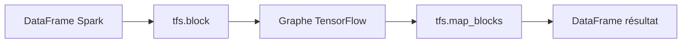

# databricks/tensorframes

> Experimental TensorFlow binding for Spark DataFrames, now deprecated in favor of pandas UDFs.

## The problem
Apply TensorFlow graphs to the columns of a Spark DataFrame without moving the data out of Spark.

## What it actually does
- Maps DataFrame columns to the placeholders of a TensorFlow graph.
- Block operations: `map_blocks`, `reduce_blocks`, `analyze` to infer dimensions.
- Python and Scala API (DSL limited to a subset of TensorFlow).
- Officially supported: Spark 2.4+, Scala 2.11, 64-bit Linux.
- The README announces a "technical preview" and areas of low performance.

## How it is wired


## Trying it
```bash
$SPARK_HOME/bin/pyspark --packages databricks:tensorframes:0.6.0-s_2.11
build/sbt tfs_testing/assembly
build/sbt distribution/spDist
```

## Cost and gotchas
Free. Spark 2.4 and Scala 2.11: old stacks. Last push in July 2024.

## What it is not
Not maintained: the README says to use `pandas UDF` instead. No official support outside Linux.

## Alternatives
`pandas UDF` (pointed to by the README): Spark's approach for applying Python code, including models, to DataFrame columns. The README names no other alternative.

## For you
Ignore: deprecated by its own authors; use pandas UDFs instead for inference on Spark.
